

<a href="https://iamhasibulhasan.vercel.app/"></a>

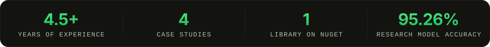


<a href="https://iamhasibulhasan.vercel.app/work/cartup-inventory"></a>
<a href="https://iamhasibulhasan.vercel.app/work/us-bangla-land-platform"></a>

<a href="https://iamhasibulhasan.vercel.app/work/people-hub"></a>
<a href="https://iamhasibulhasan.vercel.app/work/erp-system"></a>

<a href="https://www.nuget.org/packages/PatronusR"></a>
<a href="https://iamhasibulhasan.vercel.app/"></a>

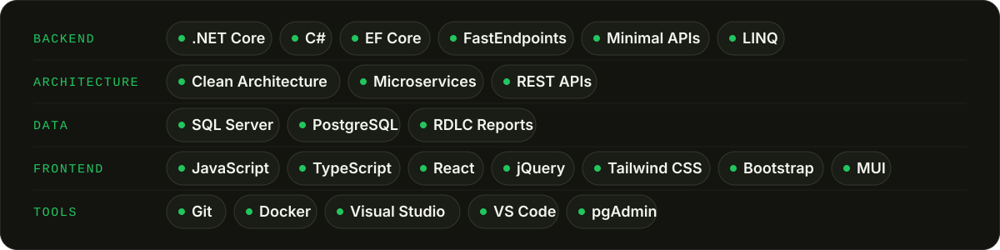

<b>More stats</b>: languages in my public repos

 

<a href="https://wakatime.com/@iamhasibulhasan">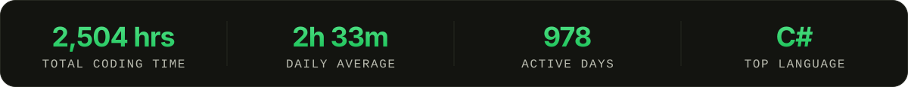</a>

<a href="https://wakatime.com/@iamhasibulhasan"></a>
<a href="https://wakatime.com/@iamhasibulhasan"></a>

<a href="https://wakatime.com/@iamhasibulhasan"></a>

<a href="mailto:mdhasibulhasan.dev@gmail.com"></a>

<!-- Profile photo, hidden. Remove the comment markers to show it again.

-->
